# 05 — Fluxos

Cada fluxo aparece uma vez: diagrama técnico (Mermaid) e, logo abaixo, o que a pessoa vê e o que
o sistema faz. Os diagramas abrem no GitHub, no VS Code (extensão Mermaid) ou em
https://mermaid.live.

Os painéis em si (abas, cards, ações) estão em [06-PAINEIS](./06-PAINEIS.md); os endpoints, em
[09-API](./09-API.md); regras e métricas do negócio, em
[07-NEGOCIO-E-MARKETING](./07-NEGOCIO-E-MARKETING.md).

## Índice

**Compra (cliente)**

1. [Jornada em resumo](#1-jornada-em-resumo)
2. [Descoberta e página do produto](#2-descoberta-e-página-do-produto)
3. [Carrinho e checkout](#3-carrinho-e-checkout)
4. [Pagamento e confirmação](#4-pagamento-e-confirmação)
5. [Webhook do Mercado Pago](#5-webhook-do-mercado-pago)
6. [Download](#6-download)
7. [Pós-venda: e-mails automáticos](#7-pós-venda-e-mails-automáticos)
8. [Newsletter (double opt-in)](#8-newsletter-double-opt-in)

**Contas e login**

9. [Cliente: cadastro e login por e-mail](#9-cliente-cadastro-e-login-por-e-mail)
10. [Cliente: login com Google](#10-cliente-login-com-google)
11. [Redefinição de senha](#11-redefinição-de-senha)
12. [Staff: login por senha (2º fator da administração)](#12-staff-login-por-senha-2º-fator-da-administração)
13. [Staff: login com Google (só professor)](#13-staff-login-com-google-só-professor)
14. [Minha conta: nome, senha e e-mail](#14-minha-conta-nome-senha-e-e-mail)

**Loja (quem vende)**

15. [Cadastro de produto](#15-cadastro-de-produto)
16. [Estrutura geral de chamadas](#16-estrutura-geral-de-chamadas)
17. [Rotina da dona da loja](#17-rotina-da-dona-da-loja)
18. [Casos extremos](#18-casos-extremos)

---

## 1. Jornada em resumo

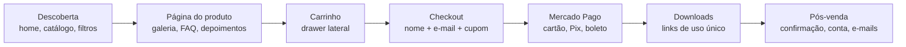

| Etapa      | Cliente vê                                     | Seção                                                        |
| ---------- | ---------------------------------------------- | ------------------------------------------------------------ |
| Descoberta | Home, catálogo com filtros, página do produto  | [2](#2-descoberta-e-página-do-produto)                       |
| Compra     | Carrinho, checkout, pagamento em nova aba      | [3](#3-carrinho-e-checkout), [4](#4-pagamento-e-confirmação) |
| Entrega    | `/downloads` com um botão "Baixar" por arquivo | [6](#6-download)                                             |
| Pós-venda  | E-mail de confirmação, conta criada, lembretes | [7](#7-pós-venda-e-mails-automáticos)                        |

Eventos de analytics (GA4 e Meta Pixel) só disparam depois do consentimento no banner LGPD
(`utils/consent.js`, `ConsentBanner.jsx`). Os eventos de funil próprios (`view_catalog` →
`view_item` → `add_to_cart` → `begin_checkout` → `purchase`) vão para `analytics_events` via
`POST /api/track-event` e alimentam a subaba Funil.

---

## 2. Descoberta e página do produto

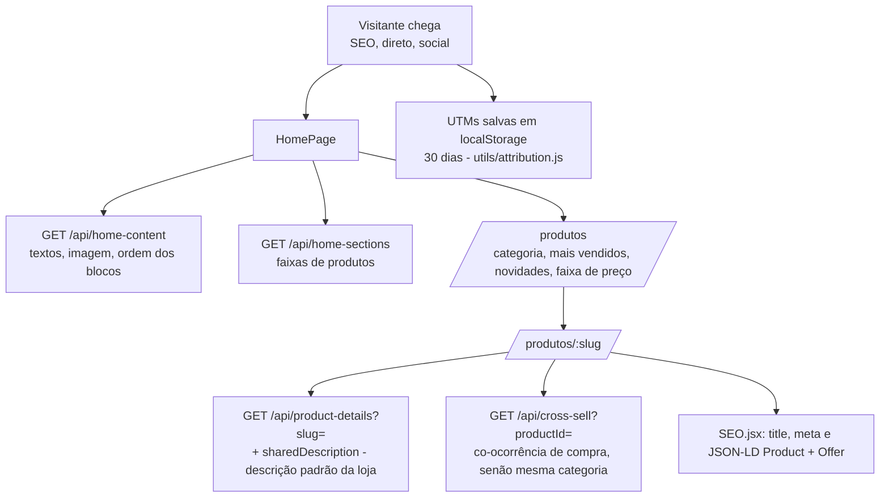

**Cliente vê.** Na home, os blocos que a dona da loja configurou na aba "Página da loja" (banner,
faixa de palavras, vitrine de produtos, passo a passo da compra, depoimentos e redes). Na página do
produto: galeria, vídeos, descrição, a descrição padrão da loja logo abaixo, preço (com preço
original riscado, se houver), benefícios, FAQ, depoimentos e produtos relacionados.

**Quem vende garante.** Categorias ativas, 3+ imagens por produto, FAQ e depoimentos preenchidos,
slug legível (gerado a partir do nome), vitrine atualizada.

---

## 3. Carrinho e checkout

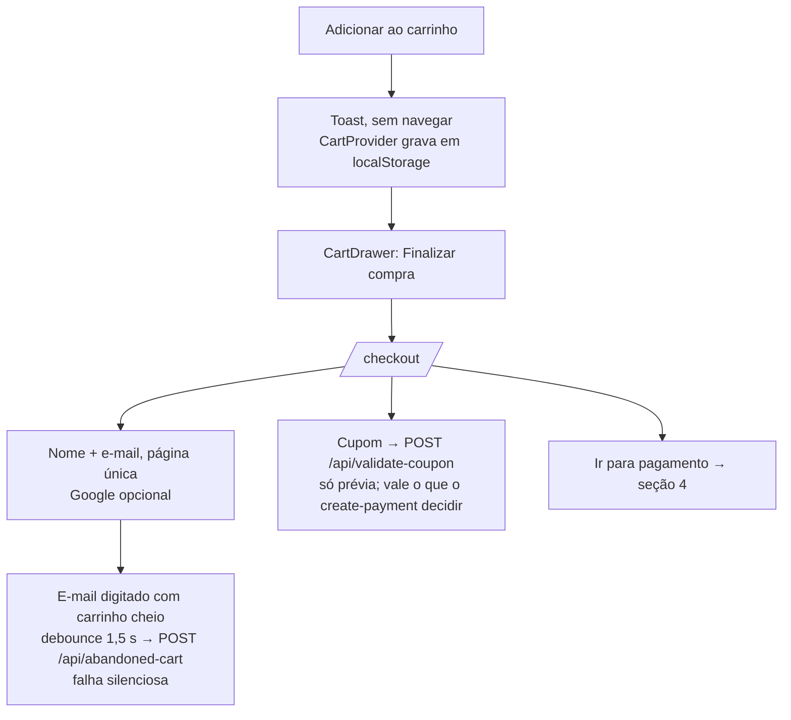

**Cliente vê.** Resumo dos itens (pode remover), formulário curto, campo de cupom com o desconto
previsto e o botão "Ir para pagamento". Não precisa ter conta: a conta é criada depois da primeira
compra aprovada (seção 7).

**Sistema.** `add_to_cart` e `begin_checkout` vão para o funil. O carrinho abandonado é gravado
por e-mail + sessão; o total é recalculado no servidor e cada atualização zera o lembrete.

---

## 4. Pagamento e confirmação

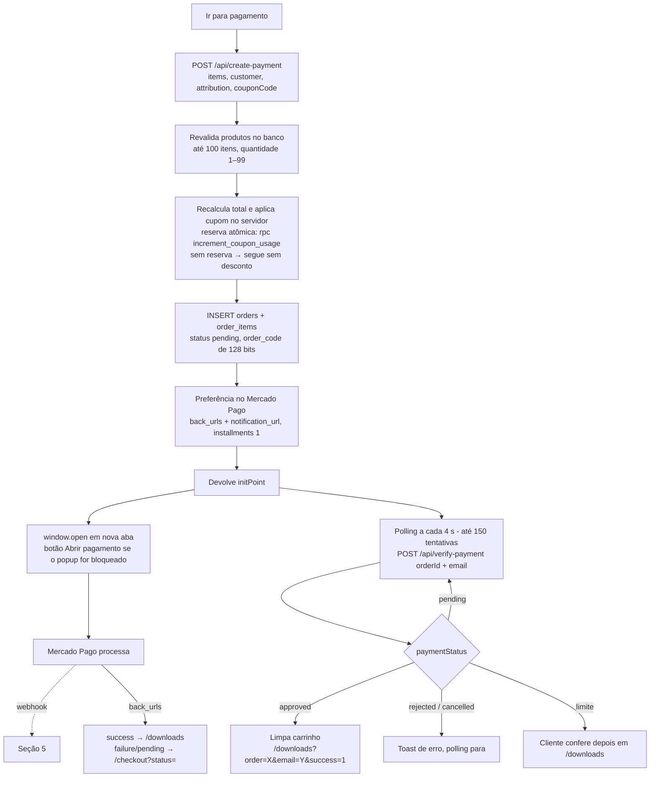

**Cliente vê.** O Mercado Pago abre em outra aba (cartão, Pix ou boleto, sem parcelamento). A aba
da loja fica esperando e, quando o pagamento é aprovado, vai sozinha para os downloads.

**Sistema.**

- Duas portas confirmam o pagamento: o webhook (seção 5) e o `verify-payment` do polling, que
  consulta o Mercado Pago (`payment.search` por `external_reference`) quando o pedido ainda está
  pendente. As duas fazem a mesma coisa na primeira aprovação: tokens de download, conta do
  comprador e e-mail de confirmação. Sem webhook (dev sem túnel, atraso em produção), o polling
  cobre.
- O `verify-payment` exige o par `order_code` + e-mail (comparação em tempo constante); par errado
  → 404 e evento de segurança.
- Erros de rede no polling aumentam o intervalo (backoff de 15 s até 5 min) em vez de martelar o
  servidor.
- Cupom reservado e não pago em 2 h volta a ficar disponível (`release_stale_coupon_reservations`).
- O evento `purchase` (GA4 + Pixel) só dispara em `/downloads`, com o pagamento confirmado, uma vez
  por pedido (`trackPurchaseOnce`).

---

## 5. Webhook do Mercado Pago

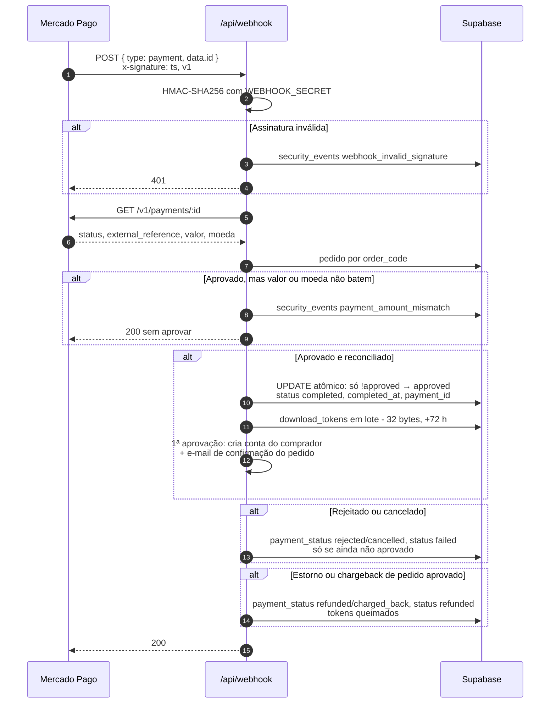

**Idempotência.** A transição de status é um UPDATE condicional: só a primeira notificação
aprovada vence. Os tokens têm `UNIQUE (order_id, product_id)`; o INSERT repetido colide (409
tratado como sucesso) e os tokens gravados são relidos. O e-mail de confirmação é idempotente por
`email_sent_log`.

---

## 6. Download

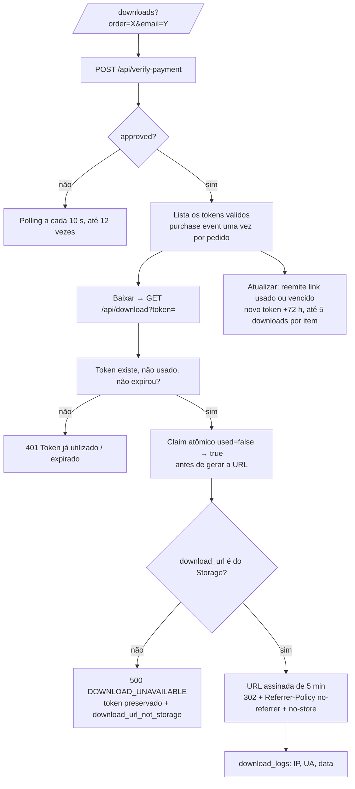

**Cliente vê.** Um botão "Baixar" por arquivo. O link vale uma vez e por 72 h; o botão "Atualizar"
gera link novo até 5 downloads por item — depois disso o item aparece sem botão. Cliente logado
vê o histórico em `/downloads` via `GET /api/customer-orders` (filtrado pelo `customer_id` do
cookie; pedidos de convidado com o mesmo e-mail confirmado são adotados pela conta).

**Quem vende garante.** Todo produto com arquivo enviado pelo painel (bucket privado
`product_files`). Link externo (Google Drive etc.) é recusado no cadastro e não é entregue.

---

## 7. Pós-venda: e-mails automáticos

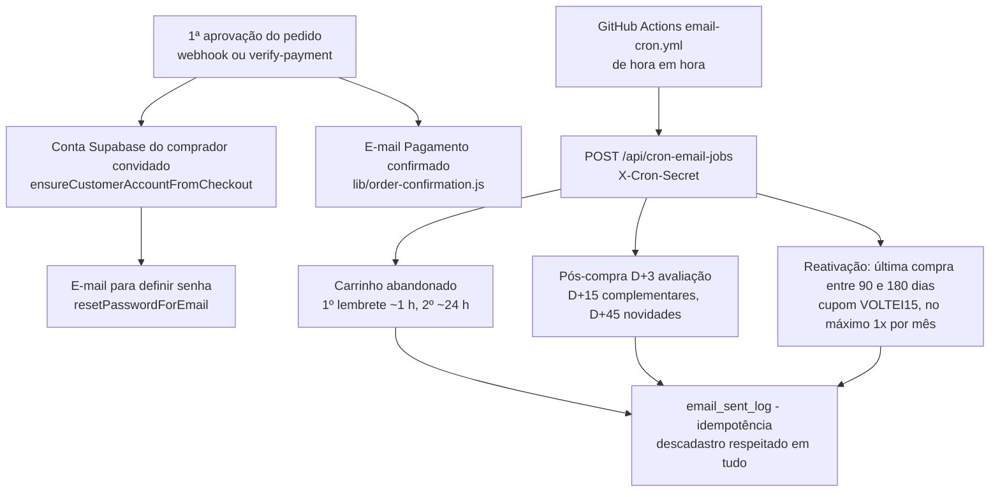

**Cliente vê.** Logo após pagar: "Pagamento confirmado" (itens e link para os downloads) e, na
primeira compra, um e-mail para criar a senha da conta criada para ele. Depois, os e-mails da
sequência, cada um com link de descadastro de 1 clique.

**Regras.**

- Lembrete de carrinho só vai para e-mail com opt-in confirmado ou com pedido aprovado (o e-mail do
  carrinho vem de um endpoint público, sem prova de posse).
- Ninguém inativo há mais de 180 dias recebe e-mail.
- Cupom de reativação só na janela de 90–180 dias, para não dar desconto a quem ia comprar de
  qualquer jeito. O código vem de `REACTIVATION_COUPON_CODE` (padrão `VOLTEI15`) e precisa existir
  na aba Cupons.
- Janelas por env: `ABANDONED_CART_FIRST_HOURS` (1), `ABANDONED_CART_SECOND_HOURS` (24),
  `REACTIVATION_DAYS_MIN/MAX` (90/180).
- Sem SMTP configurado (`SMTP_HOST/USER/PASS`), o envio registra `skipped` e o fluxo segue: e-mail
  nunca bloqueia checkout nem entrega.
- `POST /api/send-confirmation-email` reenvia a confirmação; o destinatário é sempre o e-mail
  gravado no pedido.

Quando um pedido é aprovado (webhook ou `verify-payment`), os carrinhos em aberto do mesmo
e-mail ganham `recovered_at` (`lib/cart-recovery.js`) e o cron não manda mais o lembrete.

---

## 8. Newsletter (double opt-in)

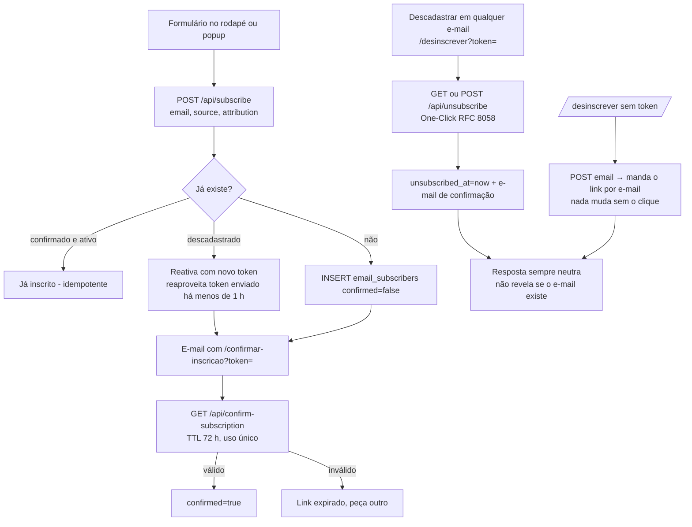

---

## 9. Cliente: cadastro e login por e-mail

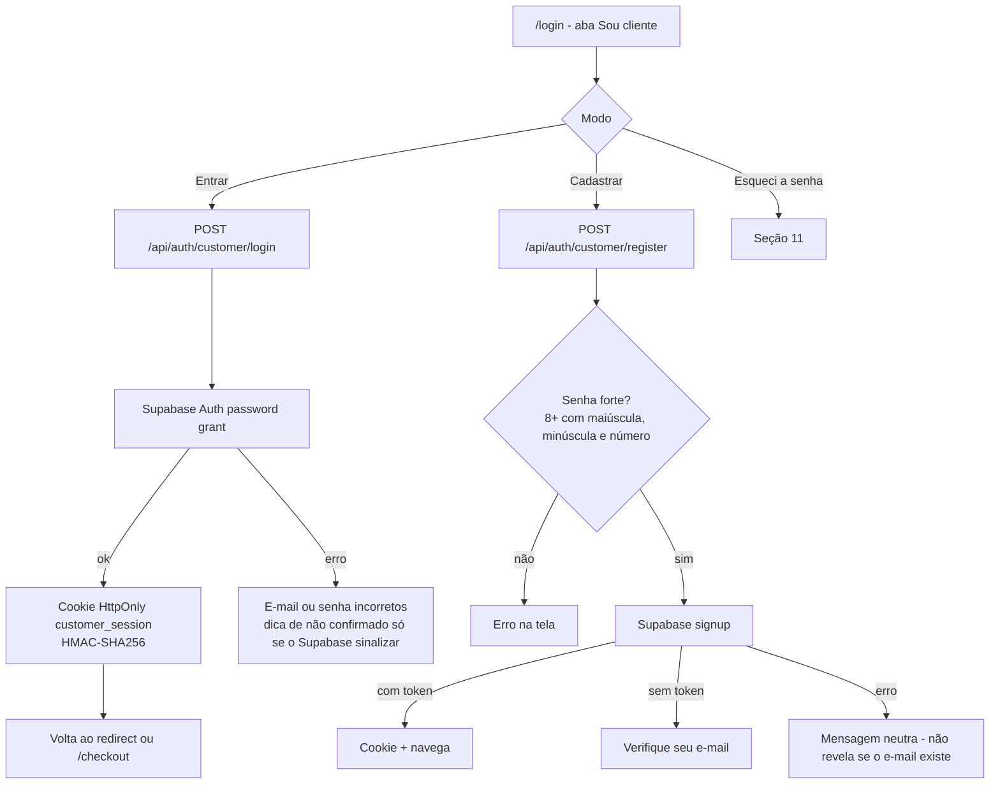

As duas telas de login abrem com o seletor **Sou cliente | Sou professor(a)**
(`LoginChooser.jsx`): ele só leva de `/login` a `/admin` e vice-versa, sem mudar a autenticação.
A política de senha é validada na tela; o servidor revalida o mínimo e traduz o erro de senha
fraca do Supabase. Em `/conta`, o cliente logado vê os dados, exporta (`/api/me-export-data`) ou
exclui a conta (`/api/me-delete-account`, que anonimiza os pedidos).

---

## 10. Cliente: login com Google

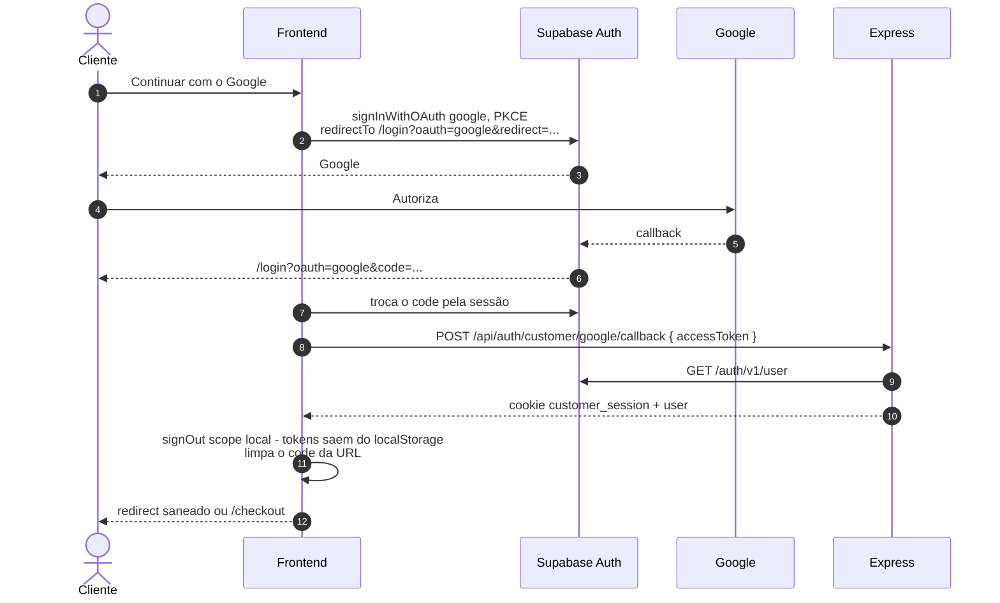

O `redirectTo` precisa estar no `uri_allow_list` do Supabase (`scripts/configure-auth.js`). O
`?redirect=` é saneado nas duas pontas (`sanitizeRedirectPath`) para não virar open redirect.

---

## 11. Redefinição de senha

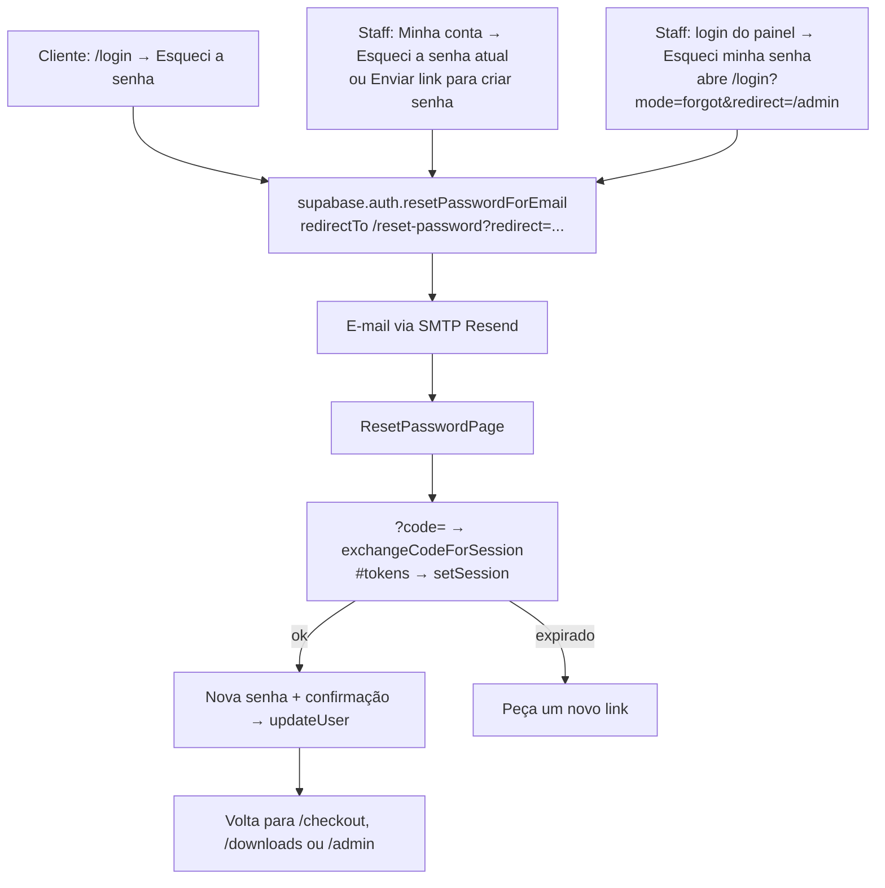

O destino depois da troca só pode ser `/checkout`, `/downloads` ou `/admin`. Pela aba Minha conta
e pelo link "Esqueci minha senha" da tela de login do painel, o link volta ao `/admin` (login do
painel).

**Pré-requisitos.** SMTP próprio no Supabase Auth (o SMTP padrão só entrega para membros da
organização); domínio verificado no Resend; em sandbox do Resend, só o e-mail dono da conta
recebe.

---

## 12. Staff: login por senha (2º fator da administração)

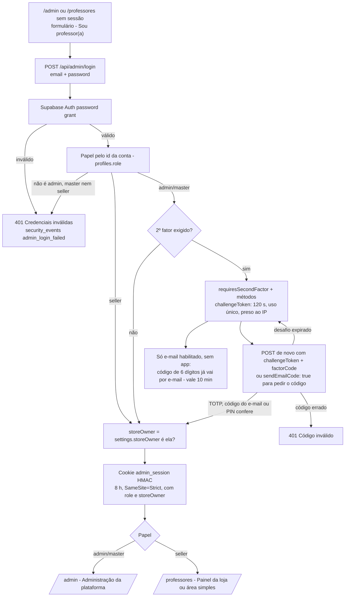

**Pessoa vê.** E-mail e senha; se for da administração com 2º fator ligado, um campo de código com
os métodos aceitos ("código do app autenticador, código enviado por e-mail, PIN de recuperação") e
o botão "Enviar código por e-mail" quando o e-mail é aceito.

**Sistema.**

- Rate limit de 5 tentativas / 10 min por IP (o sucesso também conta) e um balde separado de
  5 / 10 min por IP + e-mail para o 2º fator, que falha fechado (contador fora do ar → 503).
- Credencial errada e conta de outro papel dão a mesma resposta; o motivo fica só no log.
- TOTP aceita ±1 janela de 30 s. O código por e-mail não é guardado: vai selado (HMAC) dentro do
  próprio desafio.
- O 2º fator vale só para admin/master. Professor(a) — inclusive a dona da loja — entra só com a
  senha.
- A dona da loja é marcada no cookie no login: trocar a dona vale a partir do próximo login.
- Na mesma URL, sem sessão aparece o login; com sessão, o painel. Sair volta ao formulário.

---

## 13. Staff: login com Google (só professor)

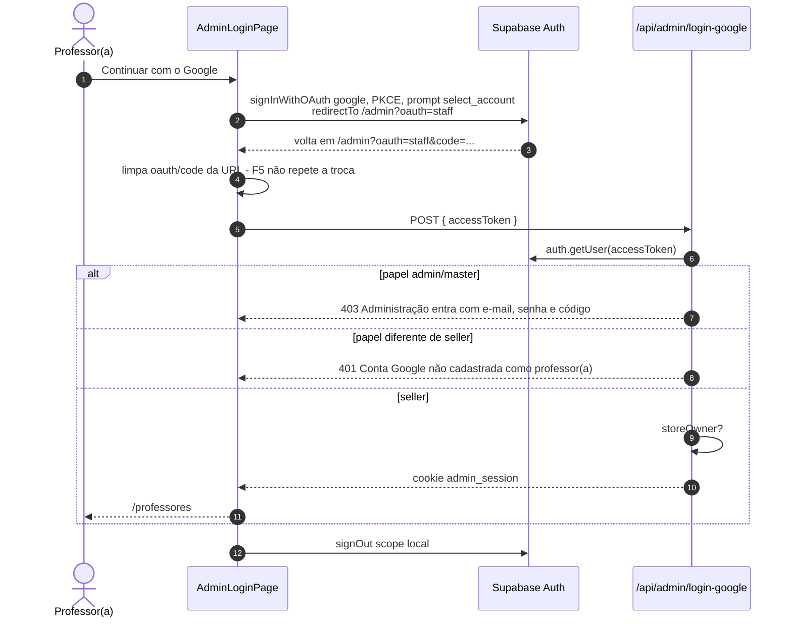

O marcador `?oauth=staff` separa esta volta da do cliente (`?oauth=google`). Admin/master são
barrados de propósito: o Google pularia o 2º fator. Uma conta Google que nunca foi professora
nasce como cliente no primeiro OAuth e recebe o 401; o admin a promove em "Professores e clientes"
e o próximo login funciona. Rate limit próprio (`RATE_LIMITS.staffGoogleLogin`).

---

## 14. Minha conta: nome, senha e e-mail

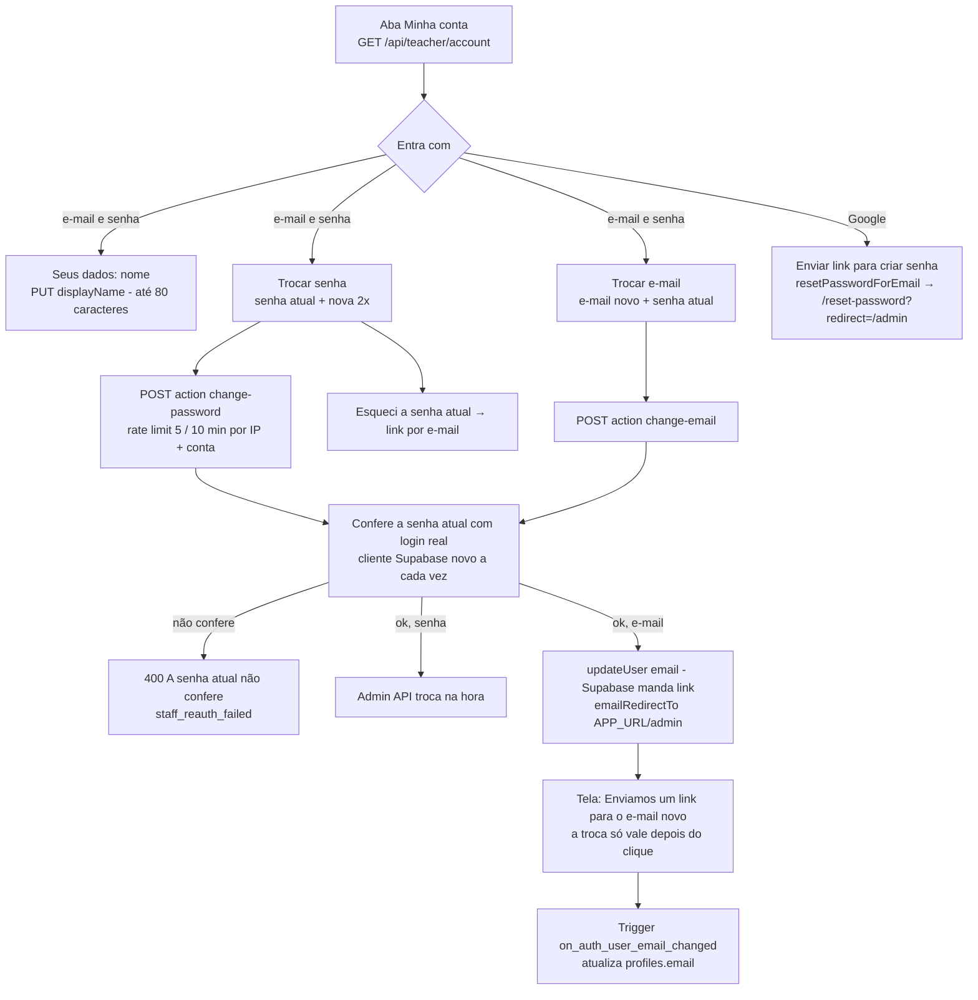

**Pessoa vê.** Nome editável; e-mail, tipo de conta ("Professor(a) · dona da loja", "Professor(a)"
ou "Administração da plataforma"), forma de login e data de criação. Contas Google veem só o botão
de criar senha: o e-mail delas é o da conta Google.

**Sistema.** Senha nova: 8+ caracteres com maiúscula, minúscula e número, diferente da atual. A
senha atual é pedida porque a sessão do painel dura 8 h. Erro de senha atual volta 400 (401 o
painel leria como sessão expirada). Cada troca grava evento de segurança e entrada no audit log.
Se a opção "Secure email change" do Supabase estiver ligada, a confirmação também passa pelo
e-mail antigo. O login por senha procura o papel pelo id da conta, então a troca de e-mail não
tranca a pessoa fora.

---

## 15. Cadastro de produto

**Dona da loja** (Painel da loja → Produtos):

```mermaid
flowchart LR
    A[Novo produto ou Editar] --> A1[Editar busca o produto completo<br/>GET /api/admin/products?id=]
    A1 --> B[ProductWizard]
    A --> B
    B --> S1[1 Básico<br/>nome, categoria, descrição<br/>+ dois botões de IA]
    S1 --> S2[2 Mídia<br/>imagens, vídeos, arquivo<br/>POST /api/admin/upload-url → PUT no Storage]
    S2 --> S3[3 Preço e tipo<br/>preço, preço original, individual/kit]
    S3 --> S4[4 Conversão<br/>benefícios, FAQ, depoimentos]
    S4 --> C{Tem id?}
    C -->|não| D[POST /api/admin/products<br/>active=true, seller_id = dona]
    C -->|sim| E[PUT /api/admin/products<br/>active preservado]
    D & E --> F[Valida mídia: imagem/vídeo https,<br/>arquivo só do Storage da loja]
    F --> G[INSERT/UPDATE products + audit log<br/>slug gerado pelo banco]
```

- Upload: imagem até 500 kB (conferido na tela; o bucket aceita até 10 MB), vídeo e arquivo até
  50 MB. O upload assinado é confirmado depois (metadados reais) e o que violar a política é
  apagado.
- IA (Gemini) no passo 1, sempre por botão e só no clique: "Escrever descrição com IA" (descrição,
  benefícios, FAQ) e "Sugerir nome, Google e preço" (nome, resumo para o Google, faixa de preço
  comparada ao catálogo). Nada entra no formulário sem clicar em "Usar…", e nada é gravado sem
  salvar. A IA recebe só o que foi digitado e nomes/categorias/preços do catálogo.
- Editar não reativa produto pausado; pausar/ativar é o botão da lista.
- A dona só lê e altera produtos com o `seller_id` dela; o de outro professor responde 404.

**Outro professor** (`/professores`, área simples): formulário curto com nome, descrição, link do
arquivo, preço e categoria → `POST /api/teacher/products` (nasce ativo e com o `seller_id` dele);
depois só pausar/ativar (`PATCH`). Sem fotos, sem edição e sem upload — ver pendência em
[06-PAINEIS](./06-PAINEIS.md).

---

## 16. Estrutura geral de chamadas

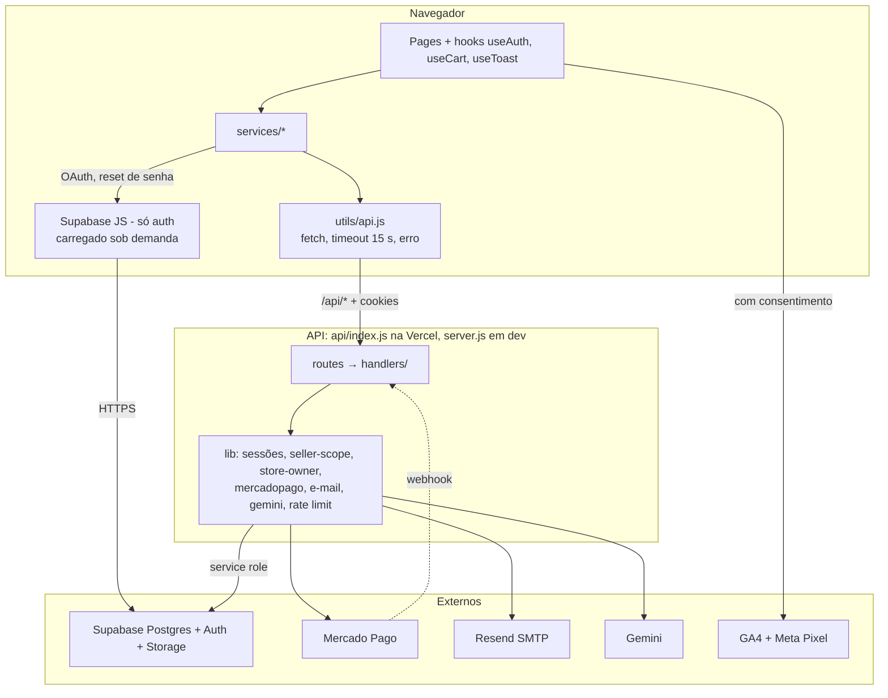

- O Express é o BFF: o navegador não lê nem grava tabela no Supabase; o cliente Supabase do browser
  serve só para OAuth, sessão temporária e redefinição de senha. A exceção é o PUT de mídia direto
  no Storage, com URL assinada emitida pelo servidor.
- A service role nunca sai do servidor.
- Três sessões independentes: `customer_session` (cliente), `admin_session` (staff: admin, master,
  professor) e a sessão do Supabase JS, apagada do `localStorage` logo após cada OAuth.

---

## 17. Rotina da dona da loja

Tudo no Painel da loja (`/professores`). O que cada aba mostra está em
[06-PAINEIS](./06-PAINEIS.md).

| Quando     | O que fazer                                                                                                                                       |
| ---------- | ------------------------------------------------------------------------------------------------------------------------------------------------- |
| Diário     | Pedidos: algum pendente ou recusado há mais de 24 h? Dashboard: números dentro do esperado?                                                       |
| Semanal    | Vendas → Estudo de vendas (gerar nova análise); escolher 1 a 3 ajustes; atualizar Página da loja e faixas de produtos se preciso.                 |
| Mensal     | Search Console (posições, páginas em queda); Curva ABC de produtos e de clientes; Segmentos de e-mail; conferir que o cupom de reativação existe. |
| Trimestral | Despublicar (pausar) produto sem venda há 90 dias, com cuidado com produto de entrada.                                                            |

Fica com a administração da plataforma: rotação de segredos e auditoria de `security_events`
([08-SEGURANCA](./08-SEGURANCA.md)), papéis e dona da loja, revisão anual das regras
([07-NEGOCIO-E-MARKETING](./07-NEGOCIO-E-MARKETING.md)) e dos planos dos serviços.

---

## 18. Casos extremos

**Cliente pagou e não recebeu o arquivo.**

1. Pedir para abrir `/downloads?order=<order_code>&email=<e-mail>` e clicar em "Atualizar": o
   `verify-payment` consulta o Mercado Pago, aprova se for o caso e reemite link usado ou vencido
   (até 5 downloads por item).
2. A dona confere em Pedidos se o pagamento está aprovado. A administração da plataforma não tem
   tela de pedidos: consulta no Supabase.
3. Mercado Pago aprovado e pedido não: procurar `payment_amount_mismatch` ou
   `webhook_invalid_signature` em `security_events` e os logs da Vercel.
4. Erro `DOWNLOAD_UNAVAILABLE`: o produto não tem arquivo do Storage. Reenviar o arquivo pelo
   painel; o token não foi gasto.

**Reembolso.** Devolver pelo painel do Mercado Pago. O webhook marca o pedido como `refunded` (ou
`charged_back`) e queima os links. Se o webhook não chegar, nada marca o pedido: o `verify-payment`
não trata estorno e a aba Pedidos não altera status.

**Cobrança duplicada.** Conferir no Mercado Pago dois pagamentos para o mesmo `external_reference`
(o `order_code`). A idempotência impede tokens em dobro, não o segundo pagamento: estornar um deles
no Mercado Pago.

**Cliente nunca recebeu o e-mail de senha.** Conferir o SMTP do Supabase Auth e se o e-mail existe
em `auth.users`. Em último caso, definir senha temporária pela Admin API:

```bash
curl -X PUT "$SUPABASE_URL/auth/v1/admin/users/<uid>" \
  -H "apikey: $SUPABASE_SERVICE_ROLE_KEY" \
  -H "Authorization: Bearer $SUPABASE_SERVICE_ROLE_KEY" \
  -H "Content-Type: application/json" \
  -d '{"password":"<senha temporária forte>"}'
```

**Cupom expirou entre o abandono e a volta.** O servidor recalcula e o pedido segue sem o
desconto; a tela não sugere alternativa.

**Professora não consegue entrar com Google.** 401 "não cadastrada como professor(a)": a conta é de
cliente — promover em "Professores e clientes". 403: é conta da administração, que entra com
senha e código.
